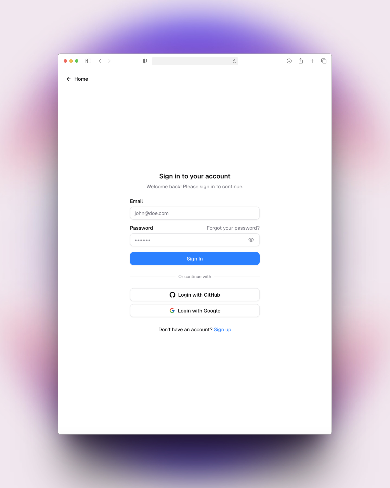
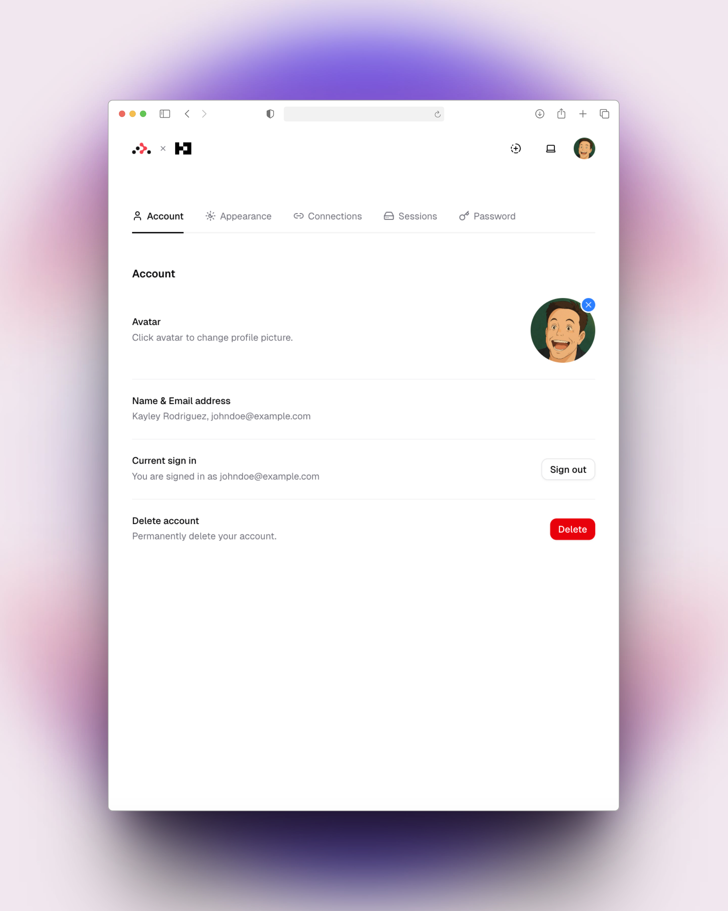

# React Router v8+ with Better auth.

This template features React Router v8+, Better auth, Drizzle ORM, and D1, designed for deployment on Cloudflare Workers.

## 🔐 Authentication Features

This template implements a complete authentication system using Better Auth with the following features:

- 📧 **Email and Password Authentication** - Secure login with email and password
- 🔑 **Password Recovery** - Forgot password and reset password functionality
- 🔄 **Social Login** - Sign in with Google and GitHub accounts
- 👤 **Session Management** - Secure session handling with Cloudflare D1 storage
- 🗑️ **Account Management** - Including account deletion functionality
- 👑 **Admin Panel** - Complete admin dashboard with user management, role-based access control

## ⭐ Core Features

- 🚀 Server-side rendering
- ⚡️ Hot Module Replacement (HMR)
- 📦 Asset bundling and optimization
- 🔄 Data loading and mutations
- 🔒 TypeScript by default
- 🎉 [TailwindCSS](https://tailwindcss.com/) and [Shadcn](https://ui.shadcn.com/) for UI styling
- 🔑 [Better Auth](https://better-auth.com/) for authentication
- 🌧️ [Drizzle ORM](https://orm.drizzle.team/) for database
- 🛢️ Cloudflare D1 for database
- 📖 [React Router docs](https://reactrouter.com/)

## Demo

Here's a preview of the app:

<div style="display: flex;">
  
  
</div>

For more demo images, check the **.assets** directory.

## Links

React Router v7 Authentication Demo Series:

- [React Router v7 Cloudflare workers template](https://github.com/foxlau/react-router-v7-cloudflare-workers) - React Router v7 Cloudflare workers template.
- [React Router v7 with Remix Auth](https://github.com/foxlau/react-router-v7-remix-auth) - Multi-strategy authentication demo using Remix Auth
- [React Router v7 with Vite+](https://github.com/lukexlau/react-router-vite-plus) - React Router 7 + Vite+ full-stack template — Hono SSR, Drizzle/SQLite, Better Auth, Paraglide i18n.

## Getting Started

### Installation

Use Bun 1.4.2+ and Node.js 24 (Node.js 22.22+ is the minimum supported by React Router's tooling), then install the dependencies:

```bash
git clone https://github.com/foxlau/react-router-v7-better-auth.git
bun install
```

Bun is the package manager for this project. Commit `bun.lock` when dependencies change. The Shadcn CLI is not a runtime dependency; use `bunx shadcn@latest add <component>` when scaffolding UI components.

CI runs `bun audit` before type checks, tests, and the production build. The dependency overrides select patched Browserslist, fast-uri, js-yaml, and Undici releases, and replace the vulnerable esbuild version in Drizzle Kit's legacy loader without changing Wrangler's esbuild. Review and remove these overrides when the upstream dependency chains are patched.

### Development

Run an initial database migration:

```bash
cp .env.example .env
cp wrangler.jsonc.example wrangler.jsonc
bun run db:migrate:local
bun run db:seed:local
```

If you modify the Drizzle ORM schema, please run `bun run db:generate` first. If you need to delete the generated SQL migrations, execute `bun run db:drop` and select the SQL migration you wish to remove.

Better Auth uses its built-in D1 database storage for rate limiting (`rate_limits`), sessions (`sessions`), and verification records (`verifications`). No KV namespace is required. After pulling schema updates, run `bun run db:migrate:local` before starting development, and `bun run db:migrate:remote` before deploying to production. Database joins are enabled with `advanced.database.joins`.

When upgrading from KV-backed authentication, existing sessions and pending verification/reset flows are not migrated. Users must sign in again or request a new verification/reset link.

Start the development server with HMR:

```bash
bun run dev
```

Your application will be available at `http://localhost:5173`.

#### Default Users (from seed)

After running `bun run db:seed:local`, you can use the following default user to sign in:

- **Admin User**: `admin@example.com` / `admin@8899`

#### Troubleshooting

If you encounter errors after pulling updates from GitHub, try cleaning the cache and dependencies:

```bash
# Clean build cache and restart (preserve .wrangler local database data)
rm -rf .react-router node_modules/.vite
bun run dev

# If the above doesn't work, reinstall dependencies using the existing lockfile
rm -rf node_modules
bun install --frozen-lockfile
bun run dev
```

### Database Commands

- `bun run db:generate` - Generate new database migration files
- `bun run db:migrate:local` - Apply migrations to local database
- `bun run db:migrate:remote` - Apply migrations to production database
- `bun run db:drop` - Remove generated SQL migrations (interactive)
- `bun run db:seed:local` - Seed local database with initial data from `drizzle/seed/seed.sql` (safe to repeat)
- `bun run db:seed:remote` - Seed production database with initial data from `drizzle/seed/seed.sql`
- `bun run db:reset:local` - Delete all local application/auth data while preserving tables and migration history
- `bun run db:delete:local` - Delete local database files

### Authentication Commands

- `bun run auth:secret` - Generate a new Better Auth secret key. Use this when setting up authentication for the first time or when rotating secrets. The generated secret should be added to your `.env` file as `BETTER_AUTH_SECRET`.
- `bun run auth:generate` - Generate and format the Drizzle/SQLite schema from `app/services/auth/auth.server.ts` at `app/services/db/schema/auth.ts`, without connecting to D1. It uses the configured adapter so plural table names are preserved. Review changes before generating/applying migrations.

These commands use the local `auth` CLI, pinned to match the installed Better Auth version. The old `@better-auth/cli` package is deprecated; update the CLI alongside Better Auth.

### Other Useful Commands

- `bun run typecheck` - Run TypeScript type checking
- `bun run test` - Run Vitest regression tests in the local Workers runtime with isolated D1/R2 storage
- `bun run test:watch` - Run Vitest in watch mode
- `bun run check` - Check formatting, lint rules, and TypeScript types
- `bun run check:fix` - Format code and apply safe lint fixes
- `bun run format` - Format code with Oxfmt
- `bun run format:check` - Check formatting without changing files
- `bun run lint` - Lint code with Oxlint
- `bun run lint:fix` - Apply safe Oxlint fixes
- `bun run preview` - Preview production build locally

## Building for Production

Create a production build:

```bash
bun run build
```

## Deployment

Deployment is done using the Wrangler CLI.

Create the D1 database and R2 bucket, then update `d1_databases` and `r2_buckets` in `wrangler.jsonc` with the generated resource details:

```bash
bunx wrangler d1 create rr7-better-auth
bunx wrangler r2 bucket create rr7-better-auth
```

To deploy directly to production:

```sh
bun run db:migrate:remote
bun run deploy
```

To deploy a preview URL:

```sh
bun run deploy:version
```

You can then promote a version to production after verification or roll it out progressively.

```sh
bun run deploy:promote
```

## Dependency Updates and Auto-Merge

Dependabot checks Bun dependencies (`package.json` and `bun.lock`) and GitHub Actions every Monday at 09:00 Asia/Shanghai. Minor and patch updates are grouped; major updates remain separate for manual review.

`.github/workflows/dependabot-auto-merge.yml` enables squash auto-merge only for verified Dependabot minor/patch PRs without maintainer changes. It never checks out or executes PR code with its write-capable token. Other PRs are not auto-merged.

Repository setup:

- Enable **Settings → General → Pull Requests → Allow auto-merge** and squash merging.
- Protect `main` with the required GitHub Actions checks **🧹 Oxc lint** and **🔎 Type check**, and require branches to be up to date. The type-check job also runs regression tests and the production build.
- Keep any required reviews enabled; auto-merge waits for them and does not automatically approve PRs. No personal access token is required.
- For public repositories, require workflow approval for **all outside collaborators**, keep default workflow permissions **read-only**, and leave **Allow GitHub Actions to create and approve pull requests** disabled. Only the isolated Dependabot metadata workflow requests scoped write permissions; PR validation does not retain checkout credentials.

The automation only enables auto-merge for Dependabot. Maintainers with write access may still manually enable GitHub's native auto-merge on other PRs, subject to the same branch protection rules.

## Questions

If you have any questions, please open an issue.
